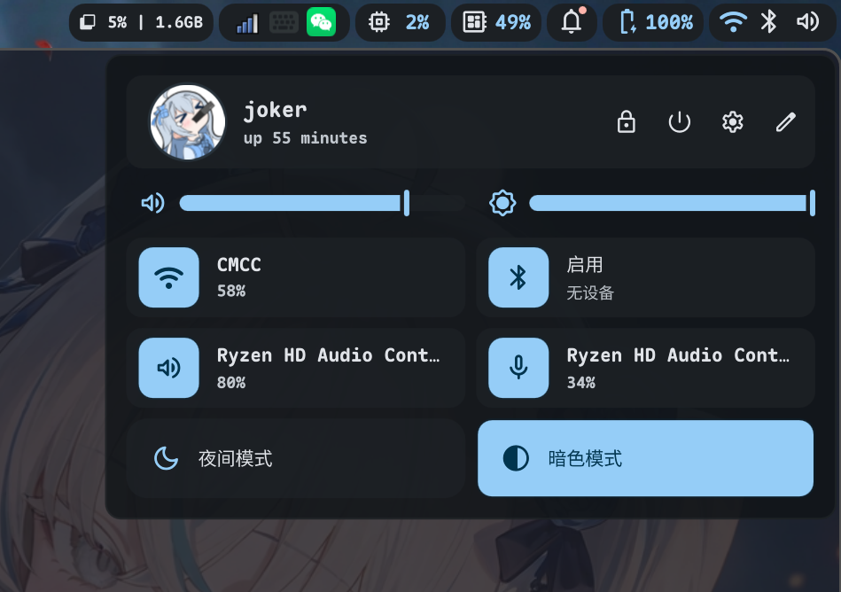
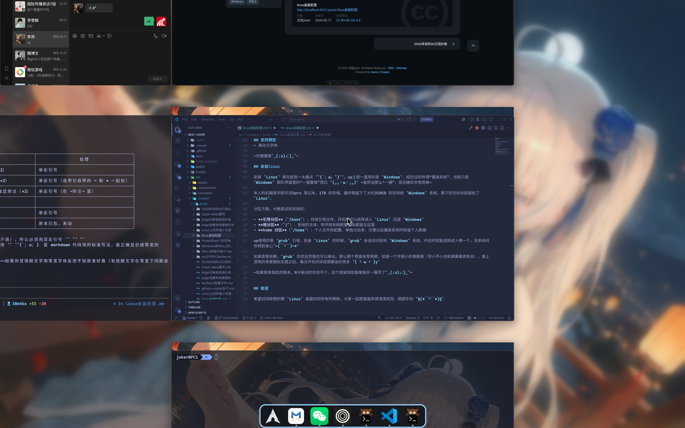

## 起因

本人最近把主力桌面环境迁移到了 `Arch Linux` + `niri` 的组合上。折腾了一阵子之后，感觉这套方案既轻量又顺手，所以打算开一个小系列记录一下 `( •̀ ω •́ )y`

`niri` 是一个基于 `Wayland` 的滚动平铺（scrollable-tiling）合成器，窗口排列的逻辑非常清晰，单显示器下用起来特别舒服。配合 `Arch Linux` 的滚动更新和庞大的软件仓库，日常基本是想要什么就有什么`~(￣▽￣)~*`

## 这套桌面

简单来说，目前的桌面由这几个部分组成：

- `Arch Linux`：基础系统
- `niri`：Wayland 合成器，负责窗口的滚动平铺
- `DMS`：这套桌面的另一块核心，后续会单独展开

## 系列预告

因为内容比较多，up打算拆成几个帖子慢慢写：

- `niri` 的基础配置与快捷键
- `DMS` 的相关配置
- 状态栏、启动器、通知等周边组件
- 美化与字体

~坑慢慢填`_(:з)∠)_`~

## 安装linux

安装 `Linux` 首先就是一大痛点 ``(´；ω；`)``。up之前一直用的是 `Windows`，经历过的所谓“重装系统”，也就只是 `Windows` 图形界面里的“一键重装”而已 `(,,・ω・,,)` ~虽然没那么“一键”，但也确实非常简单~

本人的机器是华硕天选5pro 笔记本，1TB 的存储。最终我留下了大约350GB 的空间给 `Windows` 系统，剩下的空间全部留给了 `Linux`。

分区方面，大概是这样安排的：

- **引导分区**（`/boot`）：存放引导文件，开机时可以选择进入 `Linux` 还是 `Windows`
- **根分区**（`/`）：系统的主体，软件和系统配置基本都装在这里
- **home 分区**（`/home`）：个人文件和配置，单独分出来，方便以后重装系统时保留个人数据

up使用的是 `grub` 引导。安装 `Linux` 的时候，`grub` 会自动识别到 `Windows` 系统，开机时就能选择进入哪一个，双系统共存特别省心`~(￣▽￣)~*`

如果愿意折腾，`grub` 的欢迎页面也可以美化。默认那个界面非常简陋，就是一个字很小的黑框框（字小不小也和屏幕素质有关）。换上漂亮的背景图和主题之后，每次开机的体验感都会好很多 `( •̀ ω •́ )y`

~如果是有独显的版本，N卡驱动的坑也不少，这个就留到后面单独开一篇写了`_(:з)∠)_`~

## 结语

希望对同样想折腾 `Linux` 桌面的同学有所帮助，大家一起把桌面弄得漂漂亮亮、顺顺手的 `§(*￣▽￣*)§`
